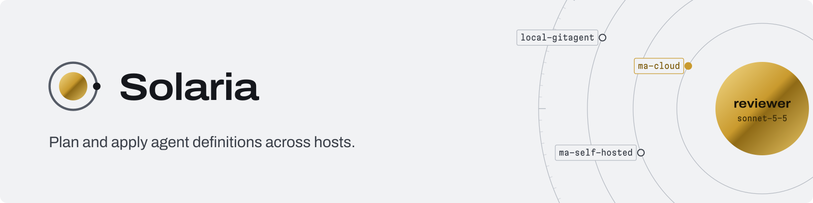

<!-- Copy to solaria-sh/.github as profile/README.md. Image URLs point at the solaria repository's main branch. -->
<picture>
  <source media="(prefers-color-scheme: dark)" srcset="https://raw.githubusercontent.com/solaria-sh/solaria/main/brand/github/banner-dark.png">
  
</picture>

Solaria is a control plane for AI agent definitions. You declare an agent once: its instructions, model, tools, skills and sandbox. Solaria plans and applies it to any host a provider supports, and records what it deployed where.

Solaria never runs the agent loop itself. The host does that. Solaria defines, deploys and tracks.

- [**solaria**](https://github.com/solaria-sh/solaria): the CLI, the definition format and the providers
- [**solaria.sh**](https://solaria.sh): install it, read the concepts, get started

Solaria is pre-alpha and Apache 2.0 licensed.
